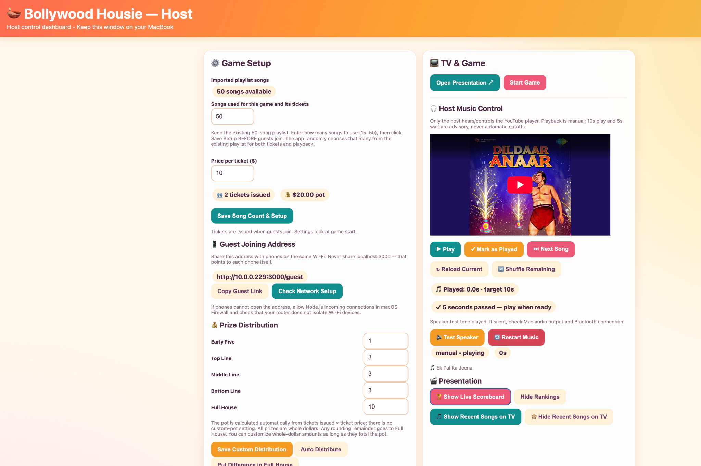
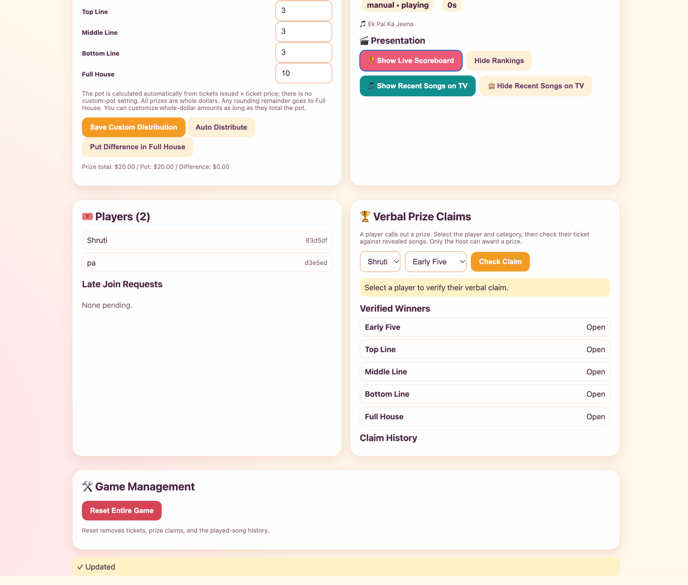
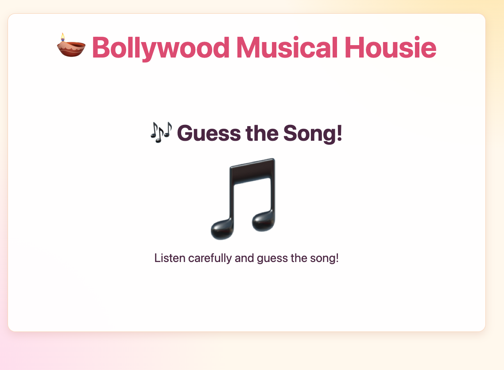
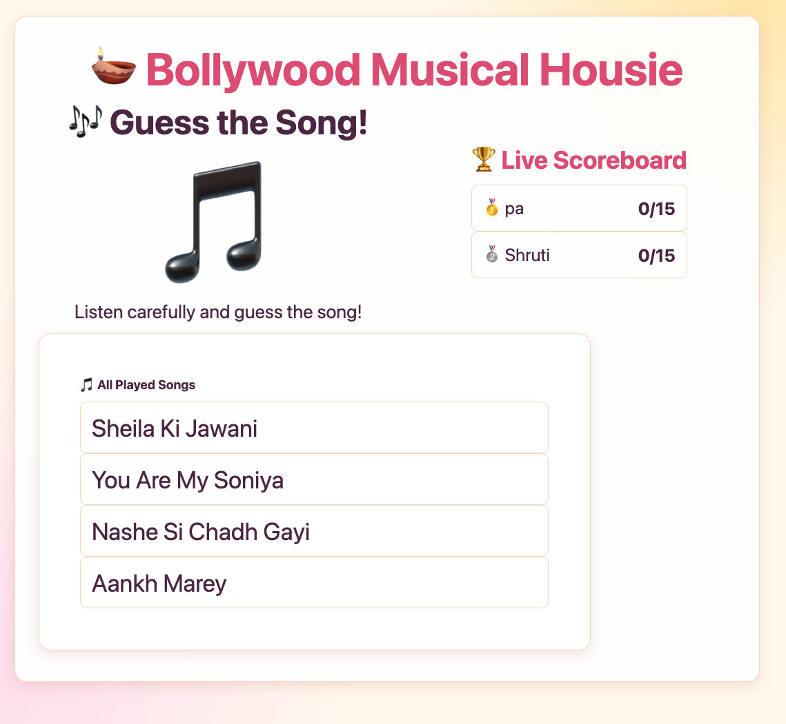
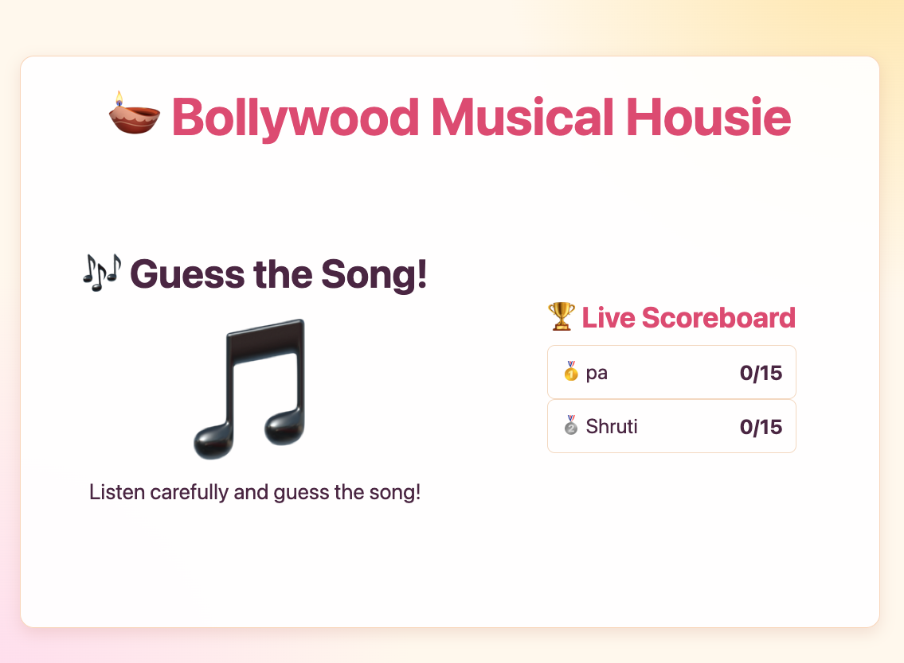

# Bollywood Musical Housie 🎶 — V38

A local-network Bollywood song guessing game inspired by Housie/Tambola. A host operates the music and game from a Mac or other computer, guests mark their own tickets on phones, and a separate TV view shows the game screen.

## V38 actual interface screenshots

These screenshots were captured from the V38 application and provided by the game host. They replace the obsolete V22 README screenshots and reflect the manual-playback design.

### Host dashboard and game setup

### Players, prize claims and game management

### TV — Guess the Song (no automatic TV countdown)

### TV — scoreboard and all played songs enabled

### TV — scoreboard enabled, history hidden

**Note:** The 10-second playback guide and 5-second wait countdown are **host-only**. The TV intentionally has no song countdown. The welcome lobby and mobile guest ticket were not provided in this screenshot set; their existing assets should not be labeled as V38 captures.

## V38 host music controls

- **Embedded YouTube player:** the host can play, pause, resume and seek. Music is never automatically stopped or advanced by the game.
- **10-second playback guide:** advisory timing on the host dashboard only. The host can keep playing longer if guests need more time.
- **Mark as Played:** records the current song without moving to the next song.
- **Next Song:** if the current song is not already marked, the host chooses **Played** or **Skip**; then the next song is loaded without autoplay.
- **5-second waiting guide:** starts immediately after **Next Song** and counts down on the host dashboard. At zero, the host may play the loaded song whenever ready; it does not autoplay.
- **Reload Current:** retries the current song without marking it played.
- **Shuffle Remaining:** shuffles only unplayed upcoming songs.
- **No Host PIN:** anyone with access to the host page on the local network can control the game. Keep the host URL private.

## TV view

- The main screen says **Guess the Song!** rather than displaying an obsolete playback countdown.
- The host can independently show or hide the **Live Scoreboard** and **All Played Songs** sections.
- Played history includes every song marked played, without song numbers.
- Song names are not automatically revealed on TV.

## Tickets and prizes

- Guests receive unique song tickets and manually mark their guesses.
- Guests submit prize claims for host review.
- Prize payouts are whole-dollar amounts, with any rounding remainder allocated to Full House.
- **Restart Music** keeps registered players and their tickets, but clears music history, ticket markings and claims.
- **Reset Entire Game** starts over, including player registrations and tickets.

## Run locally

Requirements: Node.js 20+, a modern browser, internet access for YouTube, and a shared Wi-Fi network for guest devices.

1. Download or clone the repository.
2. On macOS, open `START-MAC.command`; alternatively run `npm start` in the project directory.
3. Open `http://localhost:3000/host` on the host computer. No PIN is required.
4. Open `http://localhost:3000/tv` in a separate window to project on the TV. **Do not project the host dashboard**, which reveals song titles.
5. Configure the song pool and ticket price before guests join, then share the guest joining address or QR code.
6. Start the game. Use the embedded YouTube player and the host music controls to conduct each round.

YouTube videos may fail to load or block embedded playback; use **Reload Current** or skip a failed video without marking it played. The 10-second and 5-second timers are host guidance, not playback automation.

## Project files

- `server.js` — local HTTP server and game state
- `songs.json` — song catalog
- `public/host.html` — host dashboard and YouTube controls
- `public/guest.html` — guest tickets
- `public/tv.html` — TV display
- `public/style.css` — styles
- `CHANGELOG-V38.txt` — V38 change summary
- `VERSION.txt` — version identifier

## Testing status

V38 was tested as a local preview. YouTube playback depends on the browser, video embedding permissions and connectivity; it has not been independently verified on every device.
