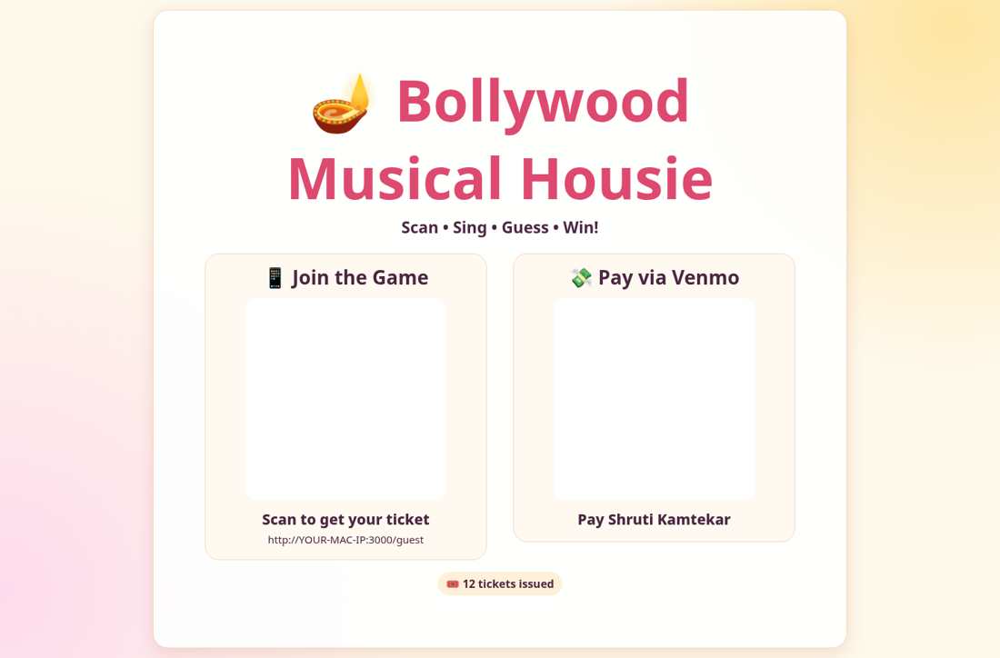
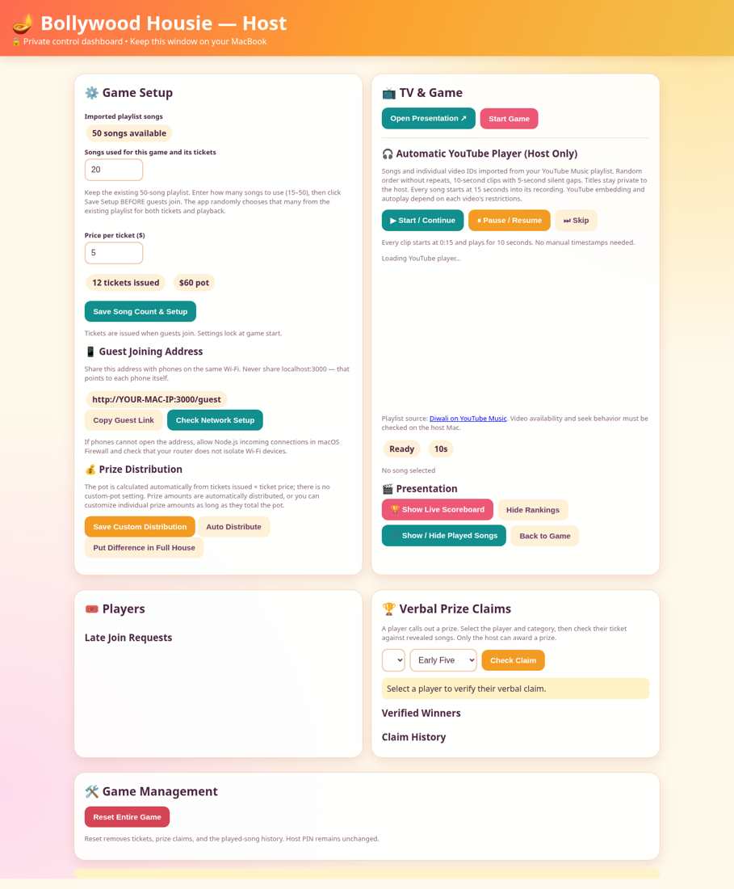
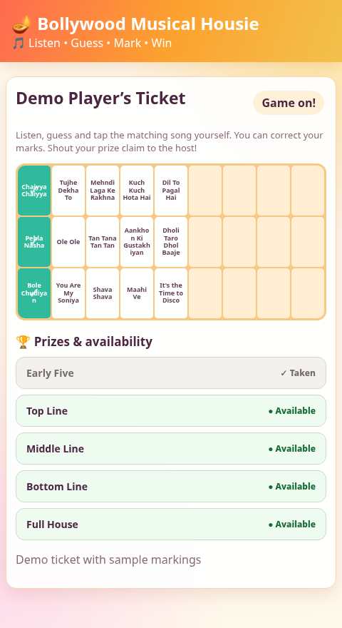
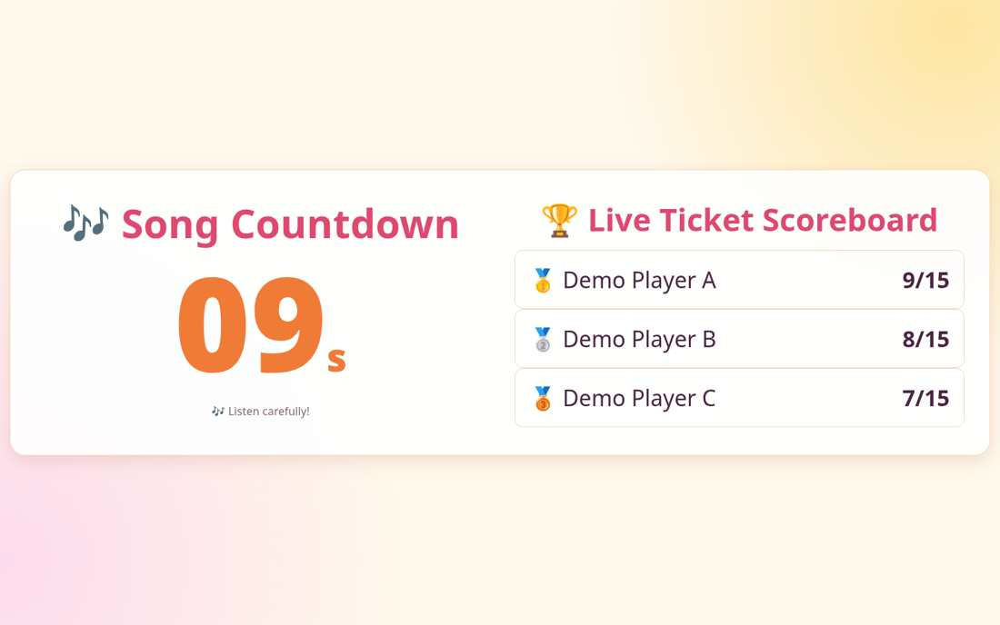
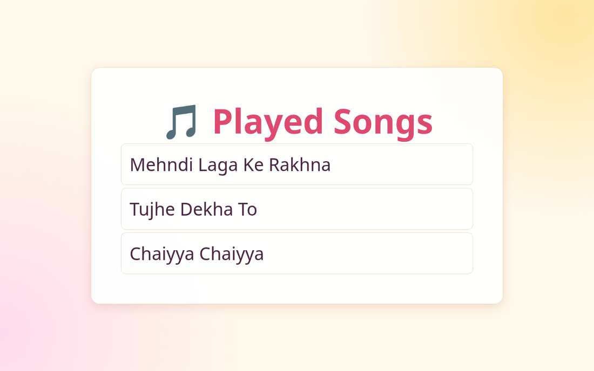

# Bollywood Musical Housie 🎶

A local, browser-based Bollywood music guessing game inspired by Housie/Tambola, built for a Diwali party.

### TV welcome lobby



### Host dashboard and game setup



### Guest registration


### Guest ticket with prize availability



### TV countdown and live scoreboard



### TV played-song history



## Features

- Host dashboard with PIN-protected controls
- Guest tickets (15 songs per ticket), join by QR code on the same Wi-Fi network
- Existing Bollywood song catalog in `songs.json`
- Host-configurable song pool size (15 up to catalog size) before tickets are issued
- Automatic clip progression: fixed start at 15 seconds, 10 seconds of playback, 5-second gap (YouTube restrictions may affect autoplay)
- TV display with song countdown and optional live ticket scoreboard
- Manual ticket marking and host-approved prize claims
- Five prize categories with availability shown as a vertical list on guest tickets
- Locally persisted game state (not committed to Git)

## Run locally

**Requirements:** Node.js 20+, a Mac or other computer, internet access for YouTube, and a shared Wi-Fi network for guest phones.

1. Download the repository or clone it.
2. On macOS, double-click `START-MAC.command`; alternatively run `npm start` in the project folder. No `npm install` is required for the current implementation.
3. Visit `http://localhost:3000/host` on the host computer and set a Host PIN.
4. Visit `http://localhost:3000/tv` in a separate browser window to project on a TV.
5. In Host Game Setup, choose the number of songs, save the setup **before** issuing tickets, and let guests join using the TV QR code.
6. Start the game and use the host playback controls. Keep the host video window private; show only the TV page on the TV.

## Repository structure

```text
server.js             Local Node.js HTTP server and game logic
songs.json            Song catalog / YouTube video IDs
public/host.html      Host dashboard
public/guest.html     Guest ticket interface
public/tv.html        TV presentation
public/style.css      Styles
START-MAC.command     One-click Mac launcher
package.json          npm start command
```

## Notes

- YouTube video availability, seeking and autoplay vary by video and browser. Test playback on your host machine before a party.
- The application is intended for a trusted local network, not deployment as a public internet-facing service without further security review.
- `game-data.json` is generated at runtime and excluded from Git because it may contain player names and game state.
- Song titles and video IDs are references to third-party content; this repository does not include music or claim rights to it.
- The original ZIP contained older version-specific readmes; this GitHub package consolidates setup instructions for V22.

## Sharing and licensing

No open-source license is included. Add a license of your choice before inviting unrestricted reuse or contributions.
